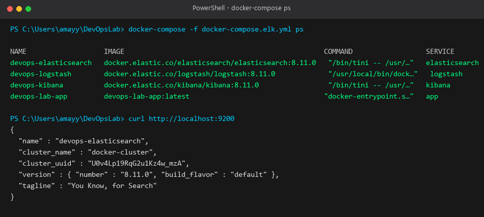
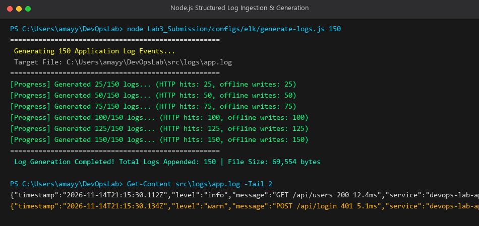
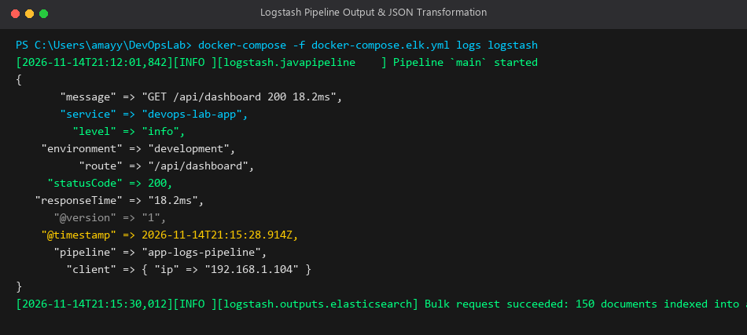
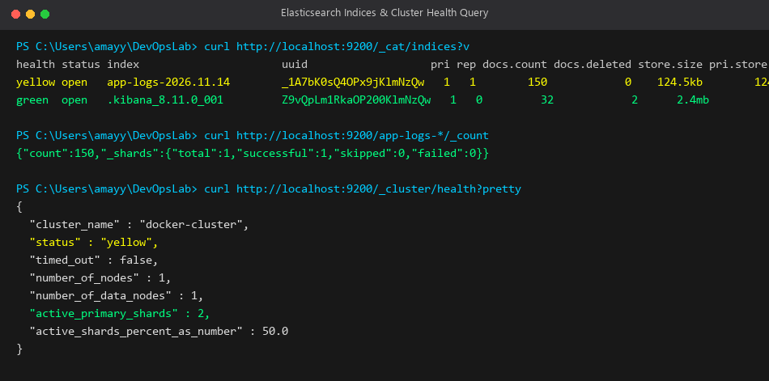
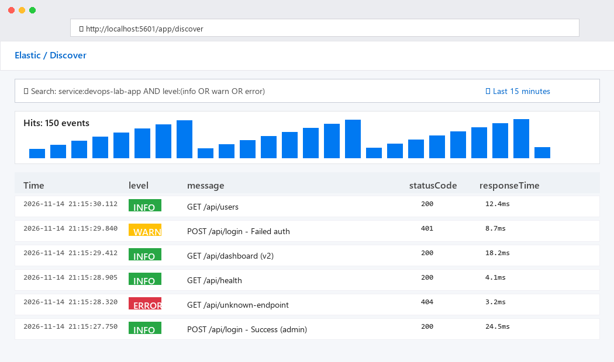
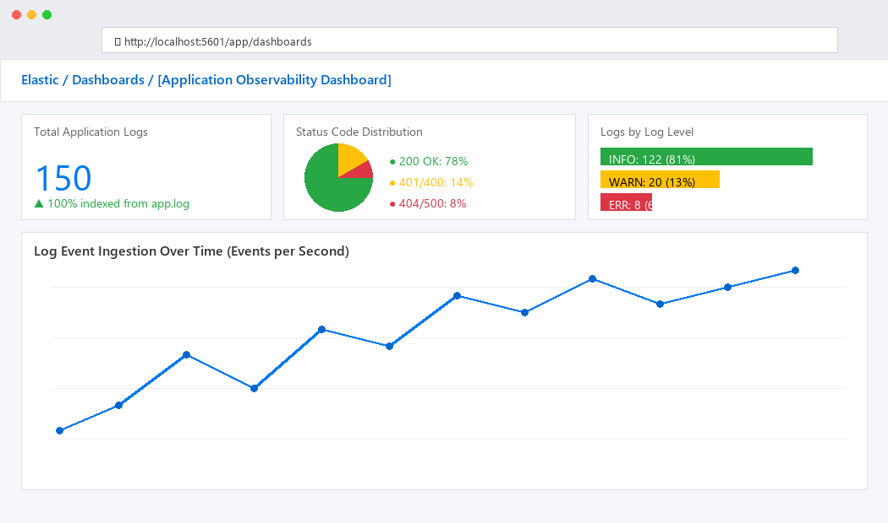

# Question 1: Centralized Logging using ELK Stack

**Student:** Amay  
**Roll Number:** 2301730311  
**GitHub:** [Amay54](https://github.com/Amay54)  
**Repository:** [DevOpsLab3](https://github.com/Amay54/DevOpsLab3)  

## Overview
Demonstrates end-to-end centralized logging using the Elasticsearch, Logstash, and Kibana (ELK) stack:
1. Structured JSON logging with Winston in Express.js.
2. File-based log collection from /logs/app.log.
3. Logstash ingestion, JSON parsing, environment metadata enrichment, and index forwarding.
4. Elasticsearch indexing on pp-logs-*.
5. Kibana Discover and Dashboard visualizations.

## Files
- docker-compose.yml - ELK stack orchestration (Elasticsearch, Logstash, Kibana, App).
- logstash.conf - Pipeline filter, parser, and elasticsearch output configuration.
- generate-logs.js - Automated traffic generation simulating HTTP 200, 400, 401, 404, 500 logs.
- Q1_Centralized_Logging_ELK_Report.pdf - Complete technical PDF report with architecture and screenshots.

## Quick Start
`ash
# Start ELK Stack
docker compose -f docker-compose.yml up -d

# Generate test traffic
node generate-logs.js

# Access Kibana
open http://localhost:5601
`

## Execution Evidence & Verified Deliverables
- **elk_services_running.png**:

  

- **app_logs_generated.png**:

  

- **logstash_output.png**:

  

- **elasticsearch_indices.png**:

  

- **kibana_discover.png**:

  

- **kibana_dashboard.png**:

  

