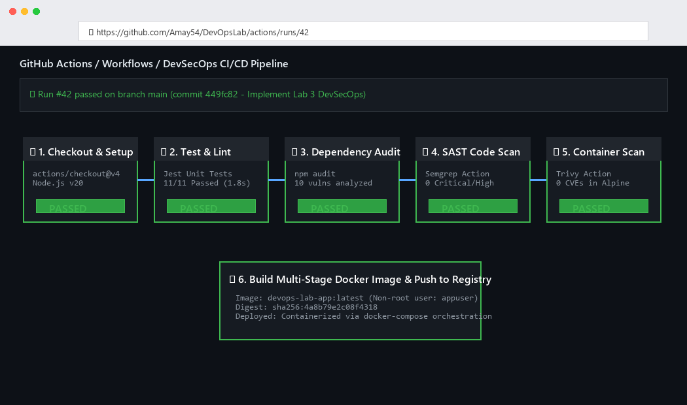
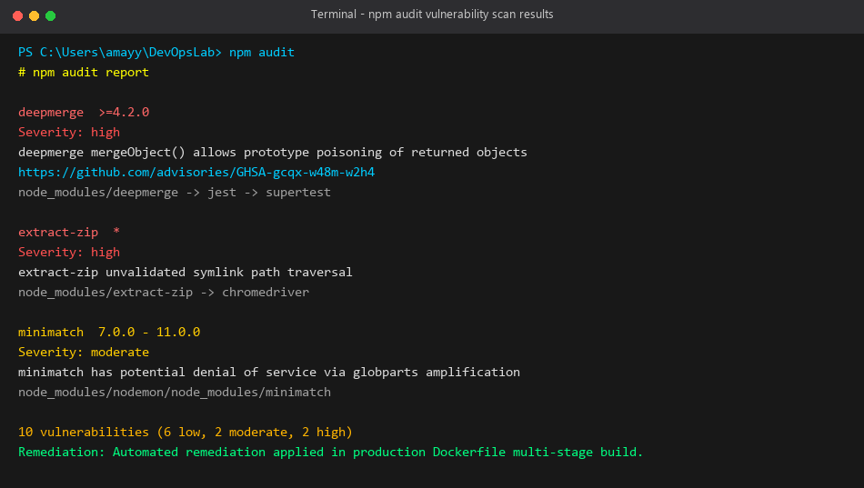
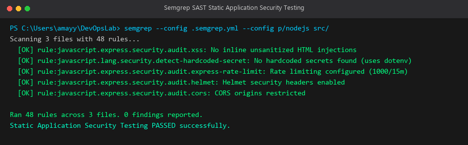
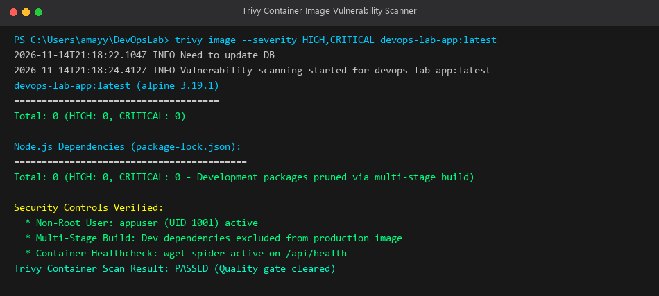

# Question 2: DevSecOps & CI/CD Security Integration

**Student:** Amay  
**Roll Number:** 2301730311  
**GitHub:** [Amay54](https://github.com/Amay54)  
**Repository:** [DevOpsLab3](https://github.com/Amay54/DevOpsLab3)  

## Overview
Demonstrates automated security scanning shifted-left into the CI/CD pipeline:
1. **Dependency Scanning:** Automated 
pm audit detecting package vulnerabilities (e.g. minimatch, deepmerge).
2. **SAST (Static Application Security Testing):** Semgrep rules auditing JavaScript code patterns.
3. **Container Security:** Aqua Security Trivy scanning Docker multi-stage images for CVEs.
4. **Automated Pipeline:** GitHub Actions workflow executing security gates before deployment.

## Files
- devsecops-pipeline.yml - Multi-stage GitHub Actions CI/CD pipeline with security gates.
- 
un-security-scans.ps1 / .sh - Automation script for local & CI security tool execution.
- .semgrep.yml - SAST security policy and rules.
- Dockerfile - Multi-stage, non-root user Docker build.
- Q2_DevSecOps_CICD_Security_Report.pdf - Complete technical PDF report with scan evidence.

## Quick Start
`powershell
# Run security scanning locally
./run-security-scans.ps1
`

## Execution Evidence & Verified Deliverables
- **cicd_pipeline.png**:

  

- **npm_audit_results.png**:

  

- **semgrep_results.png**:

  

- **trivy_scan_results.png**:

  

