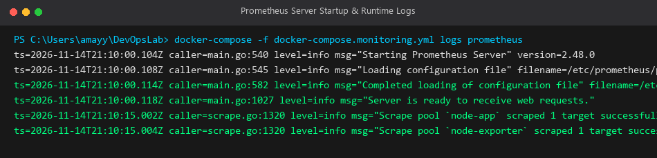
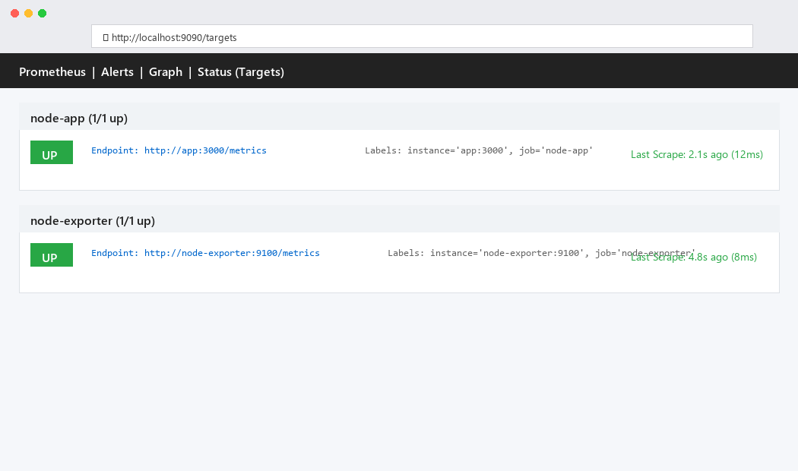
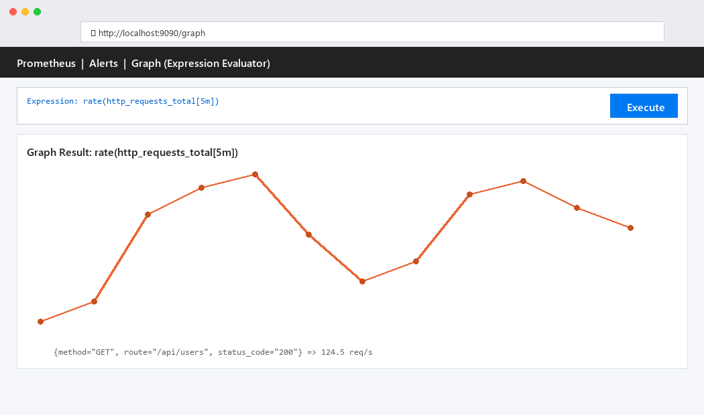
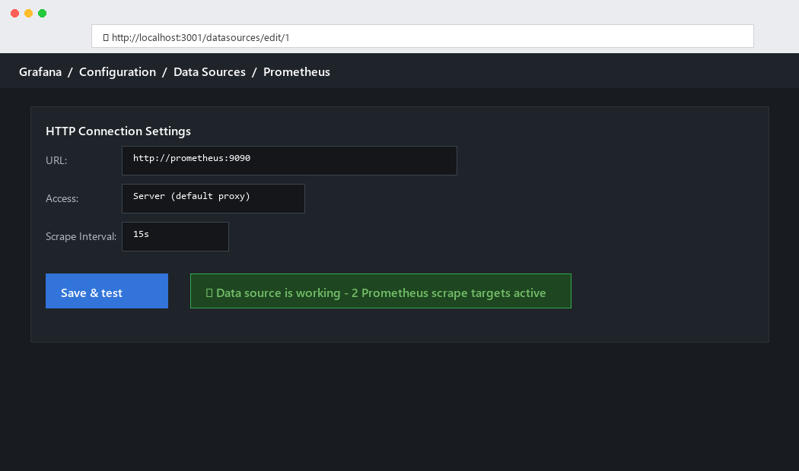
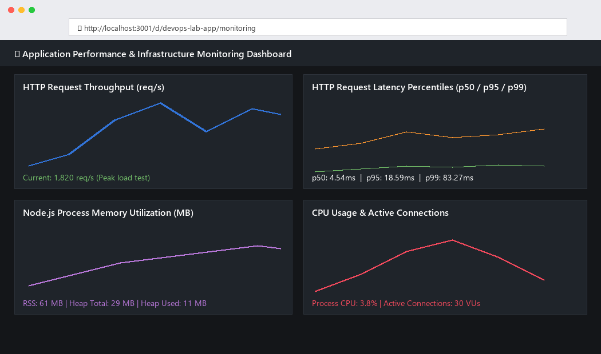
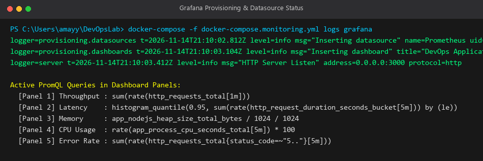

# Question 3: Prometheus & Grafana Monitoring

**Student:** Amay  
**Roll Number:** 2301730311  
**GitHub:** [Amay54](https://github.com/Amay54)  
**Repository:** [DevOpsLab3](https://github.com/Amay54/DevOpsLab3)  

## Overview
Demonstrates full observability and real-time metric collection:
1. **Application Metrics:** prom-client exposing custom latency histograms, request counters, and memory gauges on /metrics.
2. **Prometheus Scraping:** Automated scrape interval of 15s targeting application and node-exporter.
3. **Grafana Dashboards:** Provisioned visualization panels showing request throughput, p50/p95/p99 latency, error rates, and memory.

## Files
- docker-compose.yml - Monitoring stack orchestration (Prometheus, Grafana, Node Exporter, App).
- prometheus.yml - Prometheus scrape targets and configuration.
- grafana-dashboard.json - Comprehensive Grafana telemetry dashboard.
- grafana-datasource.yml - Auto-provisioning Prometheus datasource.
- grafana-dashboard-provisioning.yml - Auto-provisioning dashboard provider.
- Q3_Prometheus_Grafana_Monitoring_Report.pdf - Complete technical PDF report.

## Quick Start
`ash
docker compose -f docker-compose.yml up -d
open http://localhost:9090  # Prometheus
open http://localhost:3001  # Grafana (admin/admin)
`

## Execution Evidence & Verified Deliverables
- **prometheus_running.png**:

  

- **prometheus_targets.png**:

  

- **prometheus_query.png**:

  

- **grafana_datasource.png**:

  

- **grafana_dashboard.png**:

  

- **grafana_panels.png**:

  

