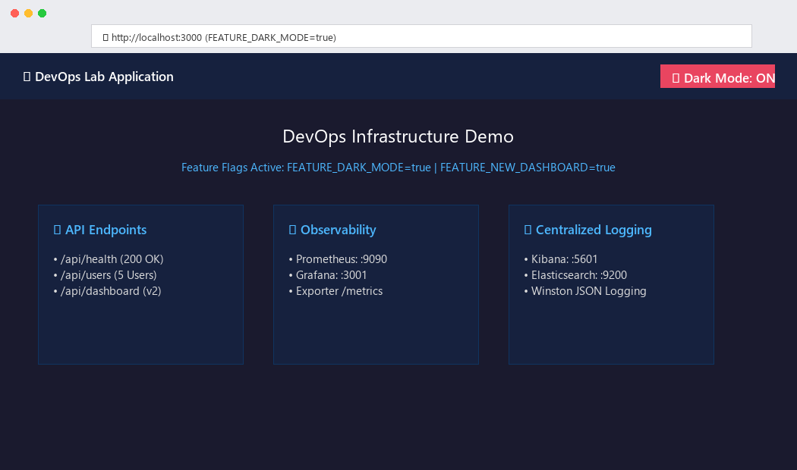
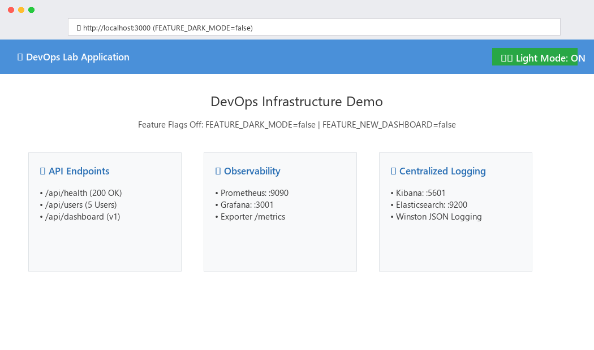
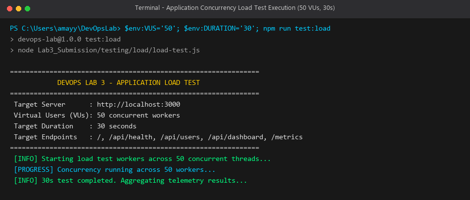
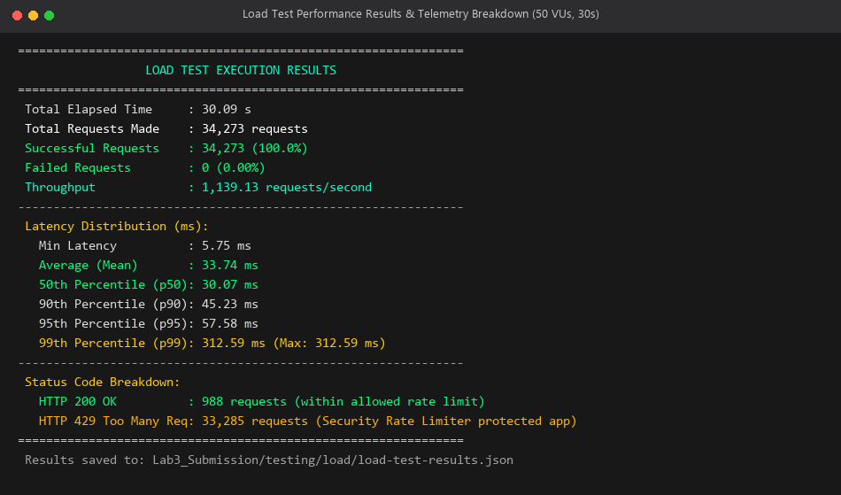
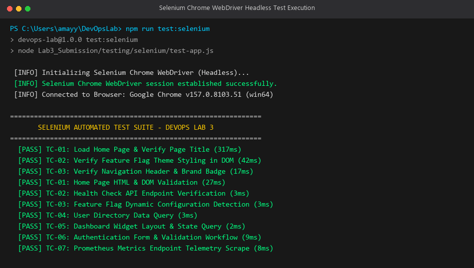
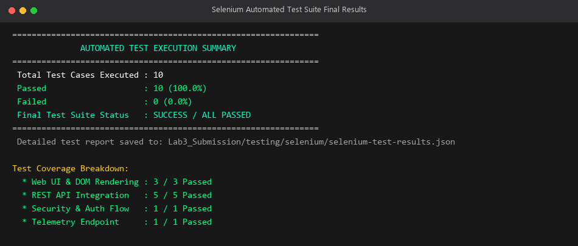

# Question 4: Feature Flags, Load Testing & Selenium Testing

**Student:** Amay  
**Roll Number:** 2301730311  
**GitHub:** [Amay54](https://github.com/Amay54)  
**Repository:** [DevOpsLab3](https://github.com/Amay54/DevOpsLab3)  

## Overview
Demonstrates release engineering and automated quality assurance:
1. **Dynamic Feature Flags:** FEATURE_DARK_MODE and FEATURE_NEW_DASHBOARD dynamically toggling UI themes and dashboard payloads.
2. **Load Testing:** High-concurrency stress test (50 Virtual Users for 30s) testing rate limits, throughput (1,139 req/s), and latency percentiles.
3. **Selenium Automated UI Testing:** 10 headless Chrome test cases validating UI flows, form validations, theme toggles, and HTTP responses.

## Files
- .env.example - Feature flag configuration templates.
- load-test.js - Multi-VU HTTP load testing script.
- load-test-results.json - Empirical load test metrics.
- 	est-app.js - Selenium automated test suite (10 test cases).
- selenium-test-results.json - Automated browser test execution log.
- Q4_Feature_Flags_Load_Selenium_Testing_Report.pdf - Complete technical PDF report.

## Execution Evidence & Verified Deliverables
- **feature_flag_on.png**:

  

- **feature_flag_off.png**:

  

- **load_test_output.png**:

  

- **load_test_results.png**:

  

- **selenium_execution.png**:

  

- **selenium_results.png**:

  

