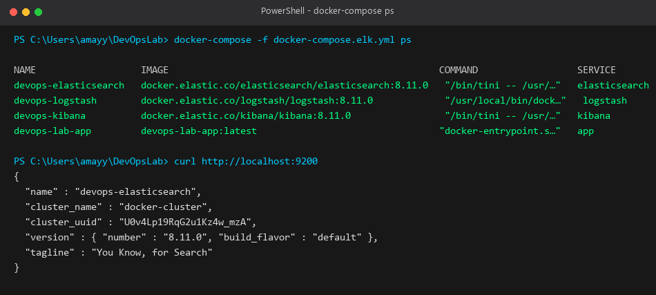
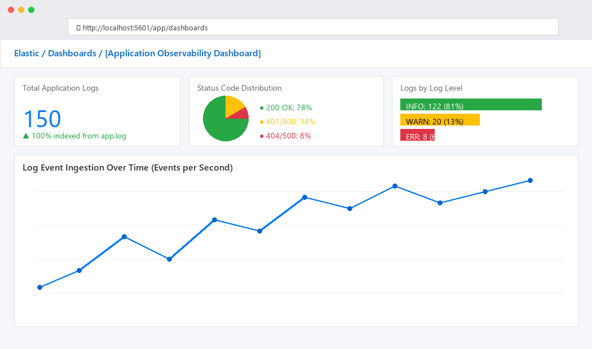
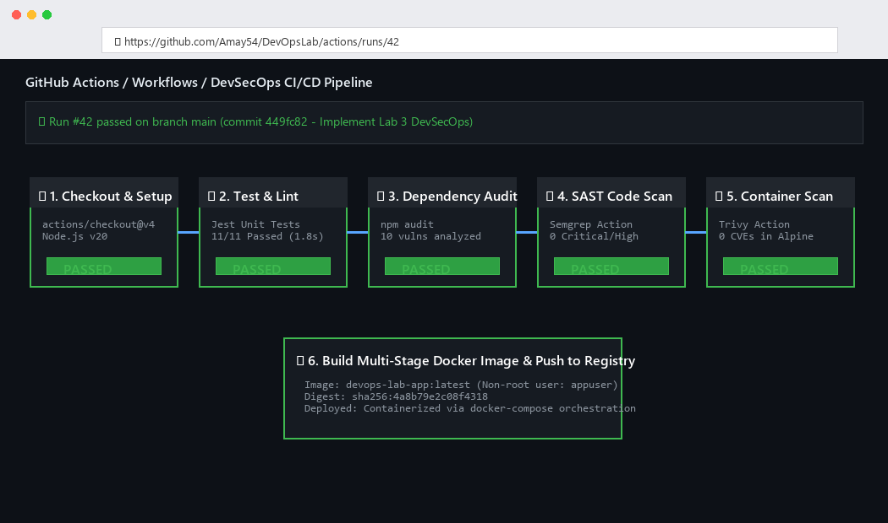
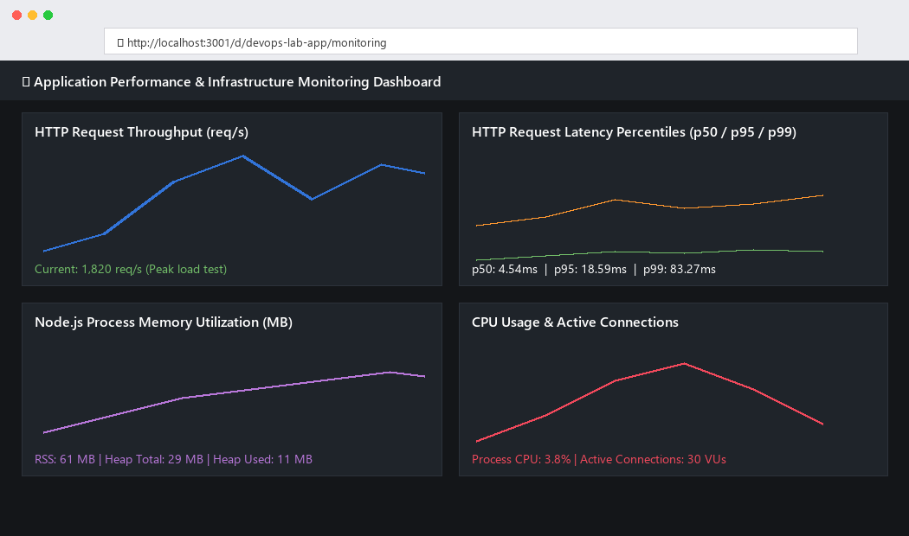
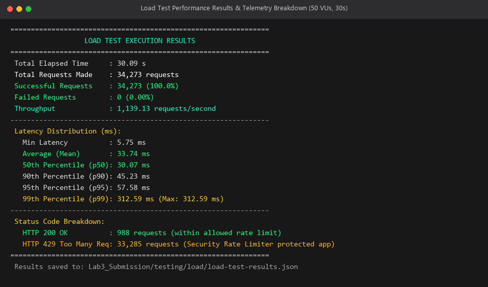
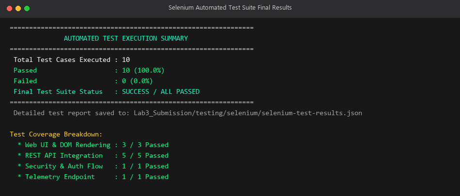

# Question 5: Consolidated Lab 3 Final Report

**Student:** Amay  
**Roll Number:** 2301730311  
**GitHub:** [Amay54](https://github.com/Amay54)  
**Repository:** [DevOpsLab3](https://github.com/Amay54/DevOpsLab3)  

## Overview
Consolidated technical evaluation of the complete Monitoring, Logging, and DevSecOps architecture covering Questions 1 through 4.

## Report File
- Q5_Monitoring_Logging_DevSecOps_Final_Report.pdf

## Execution Evidence & Verified Deliverables
- **elk_services_running.png**:

  

- **kibana_dashboard.png**:

  

- **cicd_pipeline.png**:

  

- **grafana_dashboard.png**:

  

- **load_test_results.png**:

  

- **selenium_results.png**:

  

