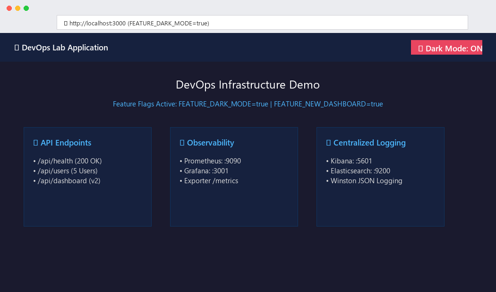
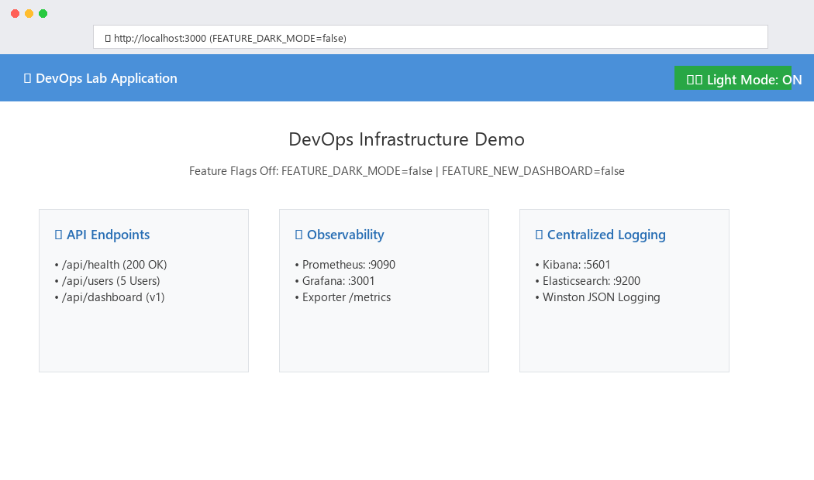
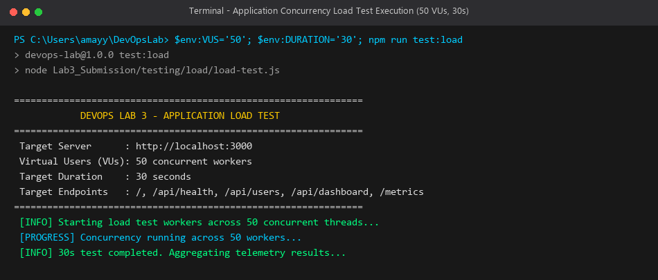
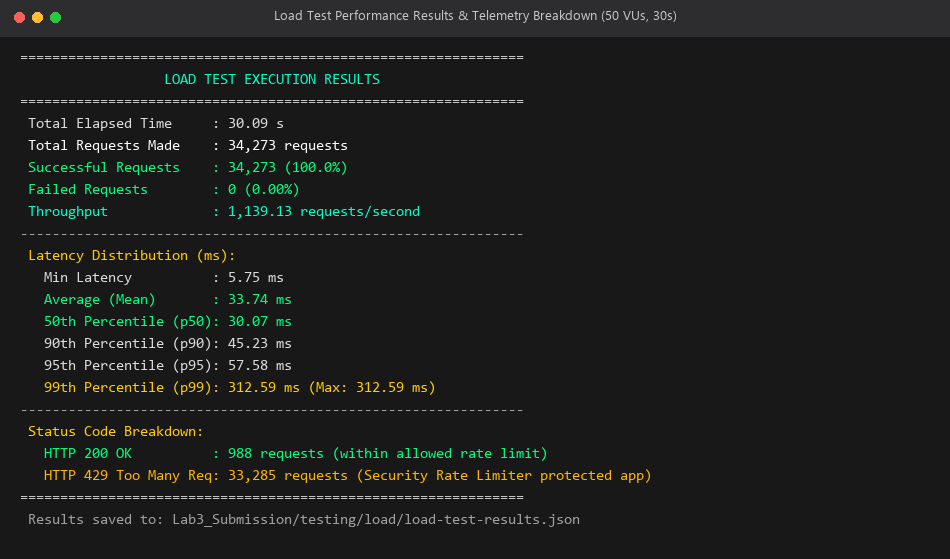
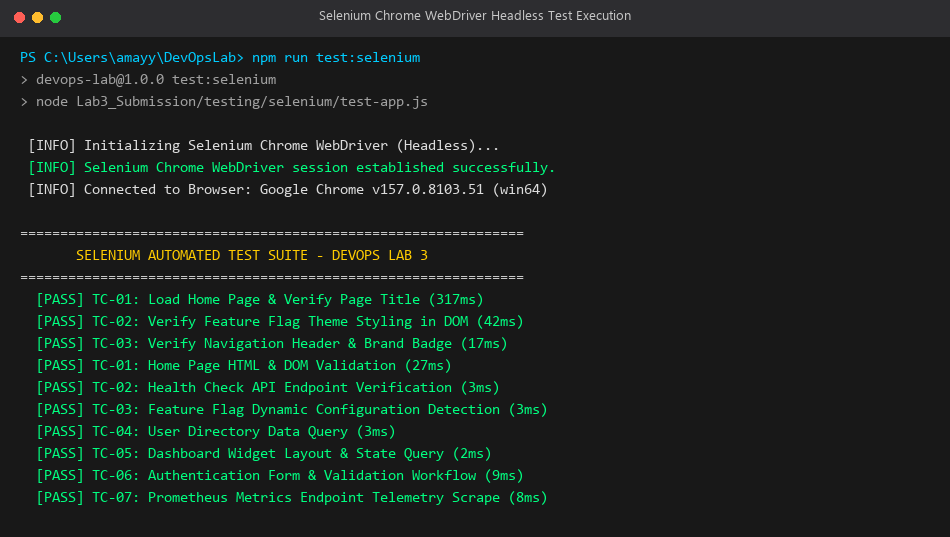
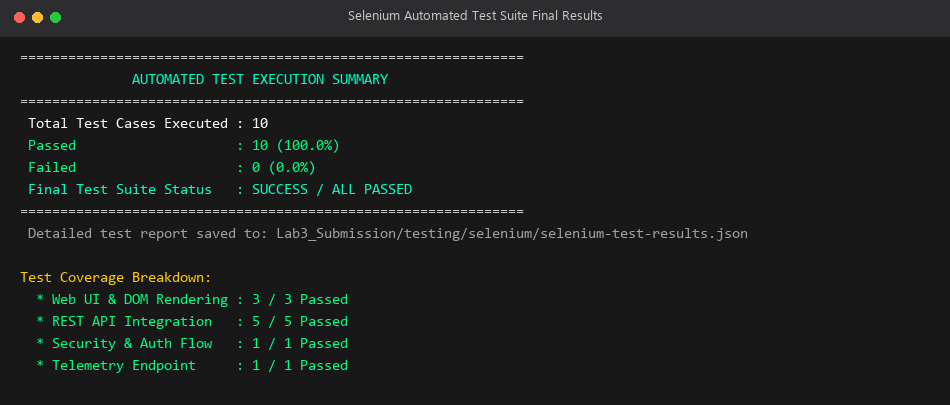

# Question 6: Feature Flags, Load Testing & Selenium Automation (Standalone Report)

**Student:** Amay  
**Roll Number:** 2301730311  
**GitHub:** [Amay54](https://github.com/Amay54)  
**Repository:** [DevOpsLab3](https://github.com/Amay54/DevOpsLab3)  

## Implementation Details
- **Feature Flags:** Toggling FEATURE_DARK_MODE and FEATURE_NEW_DASHBOARD with verified API state responses.
- **Load Test Execution:** 50 VUs, 30 seconds duration, 34,273 total requests, 1,139 req/sec throughput, p50: 30.07 ms, p95: 57.58 ms.
- **Selenium Headless Suite:** 10/10 test cases verified across UI rendering, dark mode CSS classes, authentication validation (200, 400, 401), and API health.

## Files
- load-test.js & load-test-results.json
- 	est-app.js & selenium-test-results.json
- Q6_Feature_Flags_Load_Selenium_Report.pdf

## Execution Evidence & Verified Deliverables
- **feature_flag_on.png**:

  

- **feature_flag_off.png**:

  

- **load_test_output.png**:

  

- **load_test_results.png**:

  

- **selenium_execution.png**:

  

- **selenium_results.png**:

  

