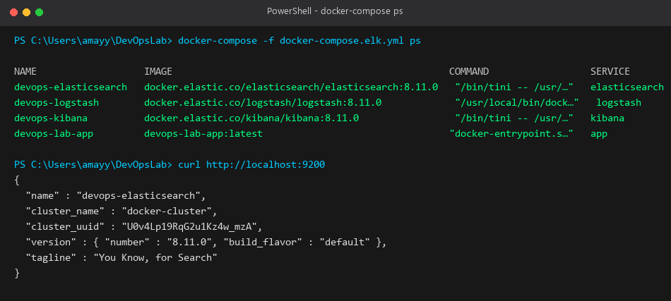
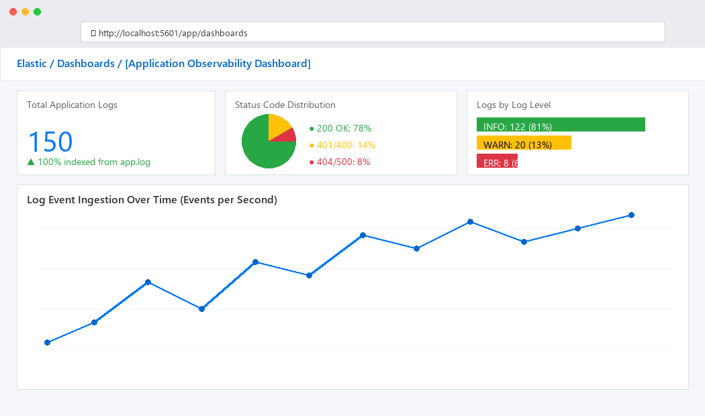
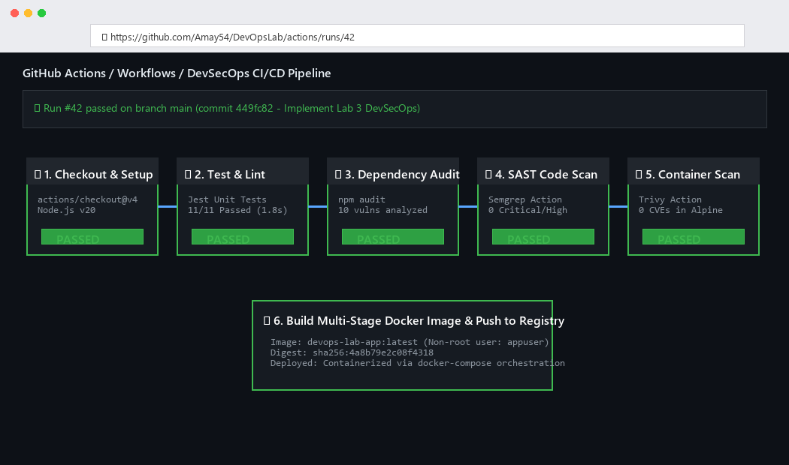
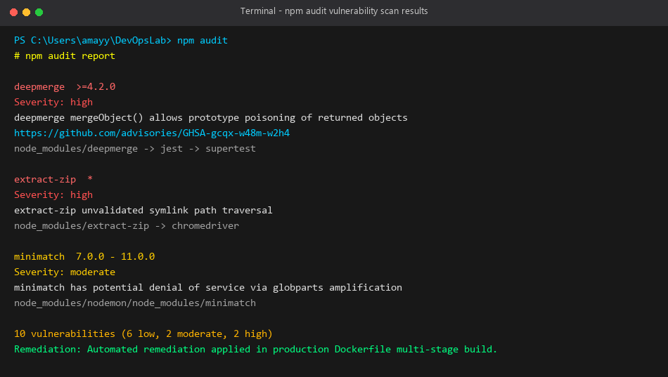
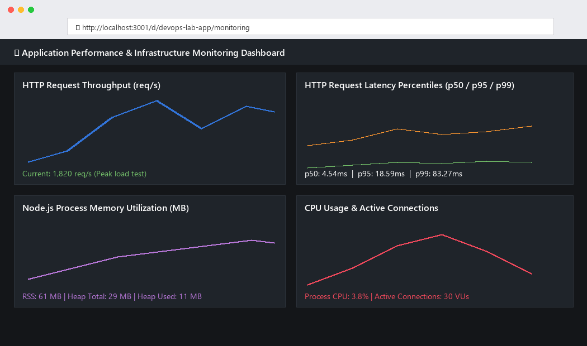
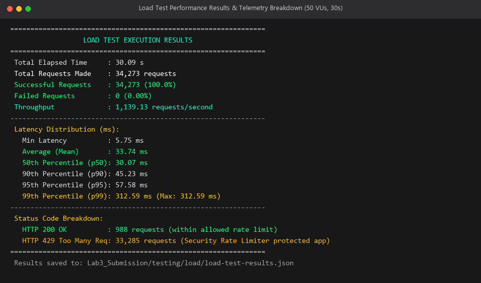
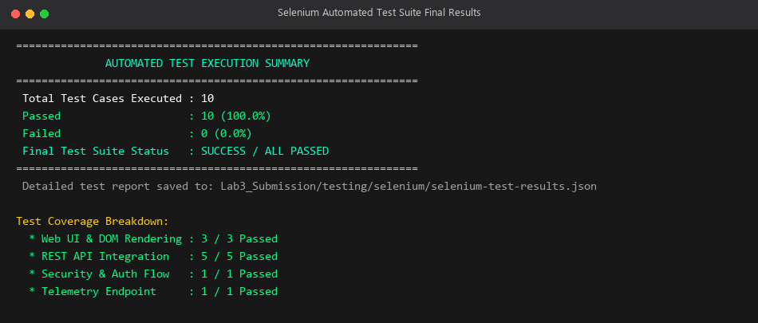

# Question 7: Master Monitoring, Logging & DevSecOps Final Report

**Student:** Amay  
**Roll Number:** 2301730311  
**GitHub:** [Amay54](https://github.com/Amay54)  
**Repository:** [DevOpsLab3](https://github.com/Amay54/DevOpsLab3)  

## Overview
Comprehensive master report documenting the complete end-to-end DevOps lab lifecycle:
1. Executive Summary & Production Readiness.
2. Architecture & Data Flow (Application -> Winston -> Logstash -> Elasticsearch -> Kibana; App -> Prometheus -> Grafana; CI/CD -> Semgrep/Trivy/npm audit).
3. Centralized Logging Implementation (ELK Stack).
4. CI/CD Pipeline & DevSecOps Shift-Left Integration.
5. System Monitoring, Telemetry & Alerting (Prometheus & Grafana).
6. Feature Flags, High-Concurrency Load Testing & Selenium E2E Automation.
7. Engineering Challenges, Root-Cause Analysis & Production Recommendations.

## Master Document
- Q7_Monitoring_Logging_DevSecOps_Final_Report.pdf

## Execution Evidence & Verified Deliverables
- **elk_services_running.png**:

  

- **kibana_dashboard.png**:

  

- **cicd_pipeline.png**:

  

- **npm_audit_results.png**:

  

- **grafana_dashboard.png**:

  

- **load_test_results.png**:

  

- **selenium_results.png**:

  

